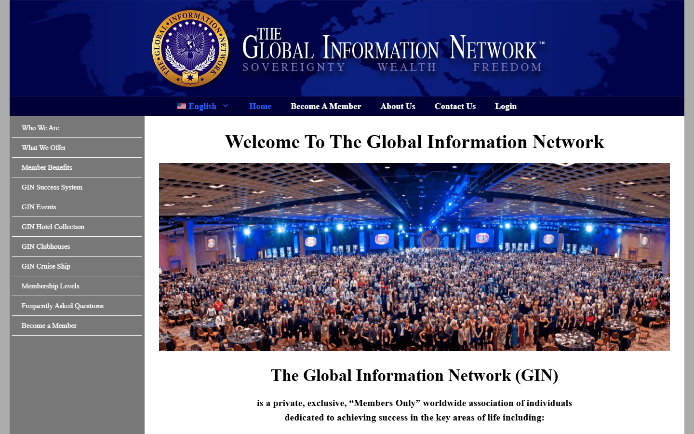
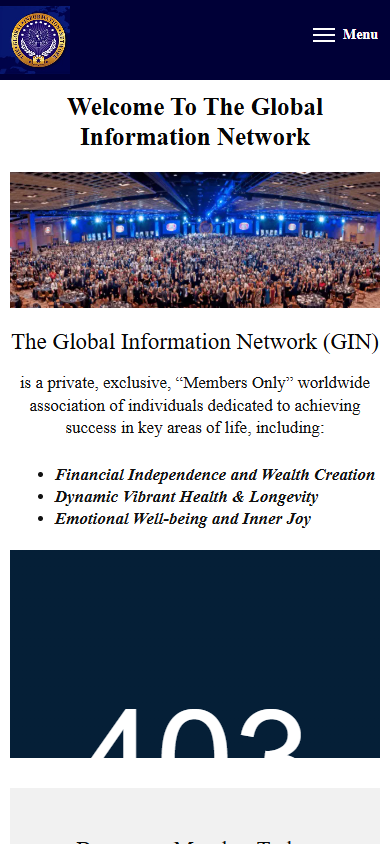
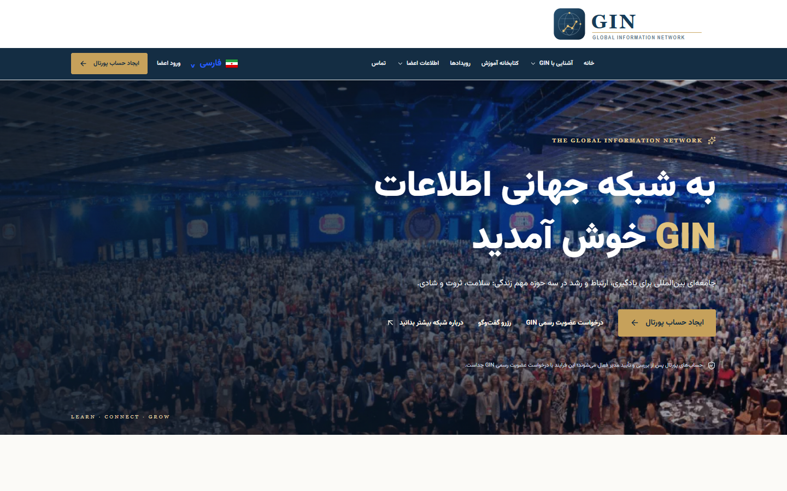

# GIN reference and production audit — 27 November 2026

This is a dated baseline for the continuing rebuild. It records the public reference inventory, the current main revision, direct production observations, and verified local checks. It is not a completion certificate: the complete 315-page WordPress collection and its 674 page URLs have not all received individual visual and interaction review.

## Repository and deployment snapshot

- Repository: `mohammad37496/GIN`
- Local project: `D:\hirmand\GIN`
- Reference: <https://globalinformationnetwork.com/>
- Vercel project: `globalinformationnetwork.liara` (Next.js)
- Main SHA checked directly against GitHub: `56c2df5d295981066388dc0ab061cd5ad8b7d87c`
- Latest production deployment: `dpl_3o3xiYMDB3BECkqcYzyVuDpZN86o`, state `READY`; deployment URL `globalinformationnetworkliara-nnhhhr1be-mohammad37496.vercel.app`
- GitHub Actions run `45973571408` (`CI`, run 94) and its `verify` check completed successfully for the main SHA. Vercel's status check for the same SHA also succeeded.
- PRs #35, #38 and #42 are merged. No open PRs were returned by the repository's open-PR search at audit time.
- The Vercel project currently lists three `vercel.app` aliases and no custom domain.

## Reference sitemap inventory

The live WordPress sitemap index returned HTTP 200 and listed nine sitemaps. The four page sitemaps contain 674 URLs, while the WordPress REST API returned 315 published page records across four batches. The page records include public, member-only, campaign and historical material; publication alone does not establish that a page belongs in the public navigation.

| Sitemap family | URLs |
| --- | ---: |
| Page sitemap 1–4 | 674 |
| Product sitemap 1–3 | 516 |
| Event-series sitemap | 12 |
| Local sitemap | 1 |
| **Total sitemap entries** | **1,203** |

Page sitemap URLs by path prefix:

| Prefix | URLs |
| --- | ---: |
| English / unprefixed | 158 |
| German (`de`) | 88 |
| Spanish (`es`) | 87 |
| French (`fr`) | 86 |
| Hungarian (`hu`) | 86 |
| Albanian (`sq`) | 86 |
| Portuguese (`pt`) | 83 |
| Persian (`fa`) | 0 |
| **Total** | **674** |

The official reference has English plus six translated locale prefixes. No Persian page URL appeared in the official page sitemap; Persian is an additional project locale. The machine-readable inventory records every URL from all nine sitemap files and all 315 published WordPress page records:

- [`official-sitemap-inventory-2026-11-27.json`](./reference-audit/official-sitemap-inventory-2026-11-27.json)
- [`robots.txt` snapshot](./reference-audit/robots.txt)

The sitemap is broader than the visible primary navigation. It includes product and event-series records and many legacy or restricted page records. Each URL still needs classification before deciding whether it should become a first-class public route, a redirect, an authenticated route or an excluded archive.

## Visible public navigation and page families

The primary navigation has Home, Become A Member (external signup), About Us, Contact Us and Login. The secondary navigation has Who We Are, What We Offer, Member Benefits, GIN Success System, GIN Events, GIN Hotel Collection, GIN Clubhouses, GIN Cruise Ship, Membership Levels, Frequently Asked Questions and Become a Member.

The official pages also link to Privacy Policy, Terms of Use and Member Agreement. The privacy link redirects from `/privacy-policy/` to `/privacy-policy-2/`. The membership application is hosted on `signup.globalinformationnetwork.com` and the booking CTA links to Calendly.

The local source currently defines 17 reference page keys for the seven public locale codes, plus dedicated home, about and contact paths. This is a focused navigation rebuild; it does not yet account for all 674 reference page URLs or the 516 product URLs.

## Current local implementation footprint

Counts taken from the current main checkout:

- 81 App Router `page.tsx` files.
- 82 API `route.ts` files.
- 33 library test files.
- 20 SQL migrations.
- Local `/sitemap.xml`: 175 URLs.
- Build output: 235 routes.

The local sitemap currently publishes 175 URLs against the reference's 674 page-sitemap URLs. This is a measurable coverage gap of 499 page URLs before considering the additional 516 product URLs and 12 event-series URLs. Some reference entries are restricted or historical, so the gap must be triaged rather than blindly recreated.

## Browser observations on production

A clean Chrome context without an authenticated session was used against the production alias. The following GET requests returned HTTP 200:

- `/`
- `/en`
- `/fa`
- `/member-home`
- `/en/contact-us`

The English root route matches the reference heading and hero structure at the first viewport. The Persian route renders its RTL home experience. The public alias was accessible without a login prompt in this browser test; Vercel's project metadata reports SSO protection configured for non-custom domains, so the effective behavior should be rechecked after any protection or domain change.

`GET /api/auth/login` returned HTTP 503 with `DATABASE_NOT_CONFIGURED`. The Vercel environment listing exposed the AWS integration variables but did not contain `DATABASE_URL` or `SESSION_SECRET`. Consequently, the member login form renders, but database-backed authentication and the other database-dependent user flows are unavailable in Production until the correct PostgreSQL connection string and a 32-character-or-longer session secret are configured. The optional admin bootstrap variables are also absent.

The payment provider module currently returns no adapter for either `stripe` or `zarinpal`; checkout is deliberately disabled and returns 503 until a real provider adapter and credentials are configured. No real payment or AWS upload was attempted during this audit.

## Media delivery finding

The reference homepage's Bunny Stream embeds loaded from the official reference origin. On the deployed GIN alias, two of the same homepage embed IDs returned HTTP 403 from `player.mediadelivery.net`; the browser showed the provider's `403 Forbidden` page inside the player. The project README already documents the required operational fix: add `globalinformationnetworkliara.vercel.app` and the eventual custom domain to the Bunny Stream allowed-embed domain list. Keep the referrer restriction enabled; do not disable it globally. This setting requires access to the Bunny Stream account.

## Visual evidence

These screenshots use matching 1440×900 and 390×844 viewports. They capture the first viewport, not the complete long page.

| Viewport | Official reference | Deployed GIN |
| --- | --- | --- |
| English desktop, 1440×900 |  |  |
| English mobile, 390×844 |  |  |
| Persian desktop, 1440×900 | Reference has no Persian equivalent |  |
| Persian mobile, 390×844 | Reference has no Persian equivalent |  |

The desktop header, hero photograph and page hierarchy are close to the English reference. Differences remain in the sidebar hierarchy, typography weight/size in the body, and the placement and presentation of the long homepage sections. At 390px both sites avoid document-level horizontal overflow, while the project uses a mobile menu and fluid content widths to keep the content readable.

## Verified local quality checks

Executed against the main SHA in the clean main checkout:

| Check | Result |
| --- | --- |
| `npm test` | 189/189 passed |
| `npm run typecheck` | passed |
| `npm run lint` | passed |
| `npm run build` | passed; 235 routes |
| `node --import tsx scripts/test-integration.mjs` | passed; 20 migrations and 39 flows |
| `node scripts/test-runtime-unconfigured.mjs` | 11/11 passed |
| `npm run test:e2e -- --workers=1` | 23/23 passed |
| `npm audit --audit-level=high` | 0 high-or-higher vulnerabilities |
| `git diff --check` | passed |

The first E2E attempt was run concurrently by two invocations and collided in Playwright's shared artifact directory. A single-worker rerun completed all 23 tests successfully; only that final run is the accepted result.

## Work in progress and boundaries

A separate `fix/visual-content-parity-20261127` worktree contains uncommitted visual and copy changes. It removes extra sidebar links and adds expanded copy for all seven locale homepages. Its current CSS diff places new homepage rules inside `@media print`, so those rules do not apply to normal screen rendering. This finding is recorded for review in that worktree; the changes remain uncommitted and are not part of main or this audit branch.

A separate committed `fix/webhook-infra-fail-closed-20261127` branch is based on the earlier `02984c7` commit and is not merged into main. It has no PR at audit time and requires a fresh review against current main before any integration. Existing worktrees and their changes were preserved.

## Open work, ordered by impact

1. Configure Production PostgreSQL and `SESSION_SECRET`, run the migration process against a backed-up database, and verify login, registration, admin bootstrap, profile, support and membership flows in Production.
2. Add the deployed Vercel hostname and any final custom domain to Bunny Stream's allowed embed domains, then verify all three homepage players and event-page players.
3. Select and implement the actual payment gateway (Stripe or Zarinpal, or another approved provider), including signature verification, retry/idempotency, refund reconciliation and end-to-end sandbox tests.
4. Classify the 674 page URLs, 516 product URLs and 12 event-series URLs by public, authenticated, historical, redirect and out-of-scope behavior; build a route-by-route parity matrix.
5. Complete full-page desktop/tablet/mobile visual and interaction audits for every public page and every locale, including forms, menus, tabs, accordions, external links and error/loading states.
6. Review the separate visual-parity and webhook-infrastructure worktrees, preserving their ownership and changes, and integrate only independently verified fixes.
7. Recheck the intended public domain, Vercel domain attachment and deployment access configuration before the final release.

The product is not yet ready for acceptance: Production database-backed workflows and payment processing are unavailable, two embedded videos are blocked by Bunny domain restrictions, and the public sitemap coverage is incomplete.
