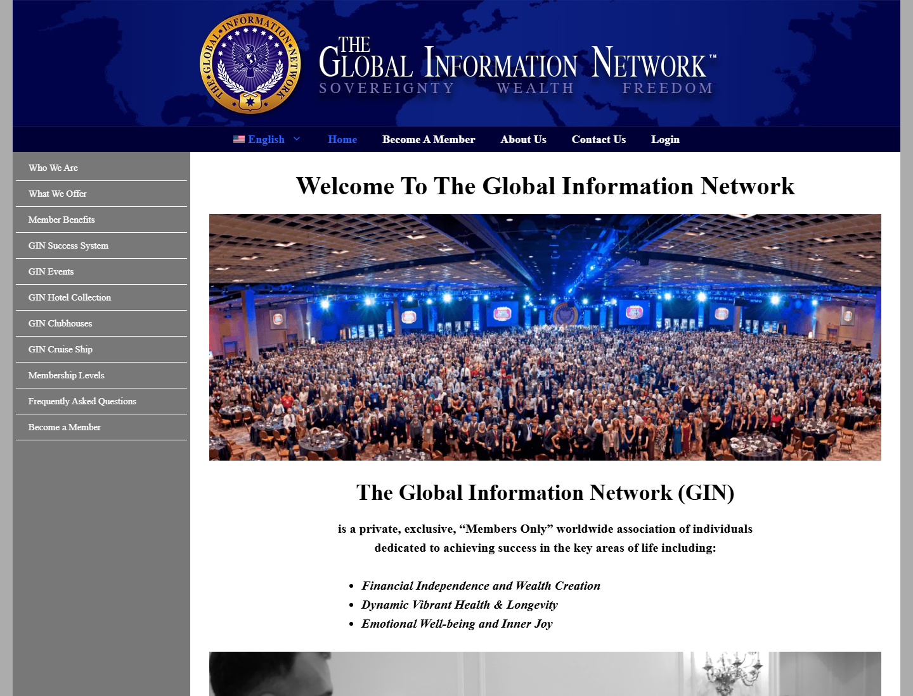
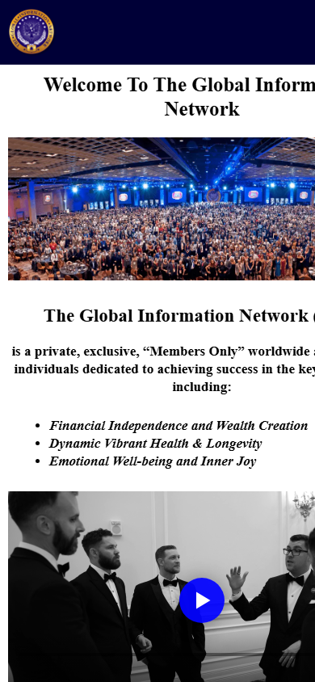

# Global Information Network reference audit

Audit date: 26 November 2026. Reference origin: <https://globalinformationnetwork.com/>.

## Verified page structure

The live homepage returned HTTP 200. The site is a WordPress installation using GeneratePress 3.6.1 and GP Premium 2.5.6. The public WordPress REST API returned 315 published pages across four page batches. The page collection also contains member-only, campaign and historical pages; the public navigation is the reliable starting point for the public rebuild.

Primary navigation:

- Home — `/`
- Become A Member — `https://signup.globalinformationnetwork.com/`
- About Us — `/about-us/`
- Contact Us — `/contact-us/`
- Login — `/member-home/`

Secondary navigation:

- Who We Are — `/who-we-are/`
- What We Offer — `/what-we-offer/`
- Member Benefits — `/member-benefits/`
- GIN Success System — `/the-gin-success-system/`
- GIN Events — `/our-events/`
- GIN Hotel Collection — `/gin-hotels/`
- GIN Clubhouses — `/clubhouses-and-lodges/`
- GIN Cruise Ship — `/the-gin-cruise-ship/`
- Membership Levels — `/membership-levels/`
- Frequently Asked Questions — `/faq/`
- Become a Member — official signup subdomain

Footer legal links:

- Privacy Policy — `/privacy-policy/` redirects to `/privacy-policy-2/`.
- Terms of Service — `/terms-of-use/`.
- Member Agreement — `/member-agreement/`.

The official site also publishes translated homepages in German, French, Spanish, Hungarian, Albanian and Portuguese. No Persian homepage was present in the homepage hreflang set. The requested project adds Persian as its own independent experience.

## Homepage order and media

The first viewport begins with the 1400×200 branded masthead, primary navigation, a secondary left sidebar, the “Welcome To The Global Information Network” heading and the wide GIN group photograph. The next sections introduce GIN, member success stories, the community proposition, the GIN success recipe, training and member benefits, a Level I membership offer, the 2028 five-night cruise invitation and a closing membership call to action.

Reference media observed in the live homepage:

- `GIN-banner-1.jpg` — masthead background and wordmark.
- `GIN-banner.webp` — wide member group photograph.
- `global-information-network-logo.png` — standalone logo asset.
- `paris-intercontinental.webp` — event/hotel imagery.
- `gin-hp-red-1.webp` — member training imagery.
- `photo_2025-08-07-11.48.44-1.webp` — member community imagery.
- `Dream-Weekend2013_GroupShot-scaled-1.jpg` — historic event image.
- `ship-vision-1.webp` — cruise imagery.
- `Levels-footer-greyscale-V2-min.png` — membership-level graphic.

## Design tokens and typography evidence

The page's inline and linked CSS declares Times New Roman for the main site text, headings, navigation, buttons and form controls. These are CSS declarations extracted from the live HTML and stylesheets; they are not a browser-computed font report.

| Element | Observed declaration |
| --- | --- |
| Body | Times New Roman; 20px desktop; 17px at 1024px and 768px breakpoints |
| H1 | Times New Roman, bold, 40px desktop; 25px at 1024px and 768px |
| Main navigation | Times New Roman, bold, 18px |
| Body line height | 1.3 |
| Page background | `#acacac` |
| Text | `#000000` |
| Navigation background | `#000037` |
| Accent blue | `#2660ff` |
| Accent red | `#ff0004` |
| Gold accent | `rgba(212,175,55,0.9)` |

The desktop layout uses a full-width image masthead, a centered dark navy primary bar, a grey secondary sidebar approximately 274px wide, and a white content area. The homepage H1 is centered above a wide hero photograph. GeneratePress mobile navigation CSS and responsive breakpoints at 1024px and 768px are present.

The captured 390px reference screenshot shows that the live site hides the desktop navigation but also clips some text horizontally. The GIN English rebuild retains the reference typography and content hierarchy while using a responsive mobile menu and fluid content widths so the local version remains readable.

## Screenshot evidence

Desktop reference, 1440×1100:

Mobile reference, 390×844:

## Implementation notes

- English uses `/en/...`, LTR document direction, the reference masthead, serif typography, navy navigation and the sidebar hierarchy.
- Persian uses `/fa/...` aliases to the existing Persian routes and keeps its current RTL layout and fonts.
- The language switcher exposes English with the US flag and Persian with the Iran flag. The selected route is shareable and the locale preference is also stored in a first-party cookie.
- Official membership application and legal documents remain linked to the official GIN origin where the portal does not own the authoritative application or legal text.
- Portal login, account registration, member support, course enrollment and event registration use the existing authenticated backend APIs.
